  

**Estagiário de Desenvolvimento na Texan Group · Técnico em Informática**

React · Node.js · Python · Java/Spring · MySQL · IA

## `> sobre`

Sou estudante do Técnico em Informática no **Colégio Técnico Bento Quirino** e estagiário de Desenvolvimento de Software na **Texan Group**, em Campinas, desde novembro de 2025.

Na Texan, trabalho em produtos internos com inteligência artificial, de plataformas web a automações com n8n e integrações entre sistemas. Também cuido de deploy com Docker, GitHub Actions e servidores Linux, sempre preservando os dados de produção.

Fora do estágio, estudo Java e Spring Boot construindo uma API do zero e publico skills open source para agentes de IA. Gosto de entender o problema antes de escrever código e de entregar soluções que funcionam de verdade.

## `> experiência`

**Estagiário de Desenvolvimento de Software · Texan Group** — nov/2025 até hoje · Campinas, SP

- **OraculoX:** plataforma de prompts da empresa, com deploy em Docker, MySQL e GitHub Actions em servidor Vultr, e login via OAuth.
- **Texan Talxs:** plataforma de podcasts com geração automatizada de cortes de vídeo usando FFmpeg.
- **Integração Texan Advisor – MVX:** conexão entre sistemas via API, com autenticação por chave e tokens em Docker Compose.
- **Automação de WhatsApp:** fluxos em n8n com Evolution API, Google Sheets e Gemini.

## `> projetos`

| Projeto | O que é | Stack |
| :--- | :--- | :--- |
| [**skill-prompt-plan**](https://github.com/danilolana/skill-prompt-plan) | Transforma reuniões e briefings em planos de prompts por etapa para Claude Code e Codex | Claude · Codex · Obsidian |
| [**skill-mega-token-saver**](https://github.com/danilolana/skill-mega-token-saver) | Reduz o consumo de tokens em agentes de IA sem perder qualidade técnica | Codex · Claude |
| [**skill-obsidian**](https://github.com/danilolana/skill-obsidian) | Conecta o chat ao cofre do Obsidian e o alimenta durante a conversa | Claude · Obsidian |
| [**skill-professor-obsidian**](https://github.com/danilolana/skill-professor-obsidian) | Professor socrático que ensina a partir do seu próprio material de estudo | Claude Code · Obsidian |
| [**maplife**](https://github.com/danilolana/maplife) *(em desenvolvimento)* | API REST para mapear hábitos, escrita à mão para estudar arquitetura em camadas e SOLID | Java 21 · Spring Boot · MySQL |

## `> stack`

  <table>
    <tr>
      <td align="center" width="33%">
        <strong>FRONT-END</strong>
          
        
      </td>
      <td align="center" width="33%">
        <strong>BACK-END</strong>
          
        
      </td>
      <td align="center" width="33%">
        <strong>FERRAMENTAS</strong>
          
        
      </td>
    </tr>
  </table>

## `> atividade`

  

 

  Entender o problema primeiro. Entregar o que funciona.

